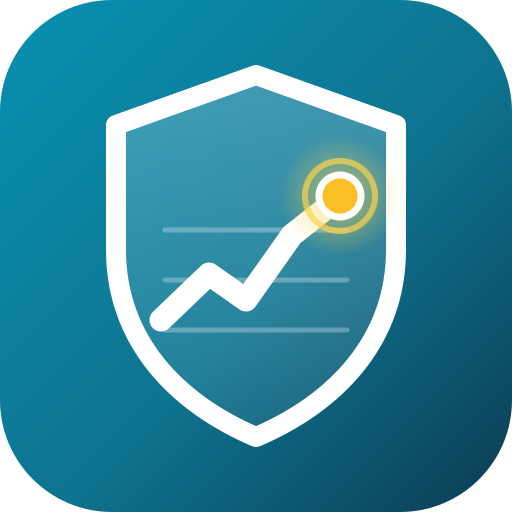
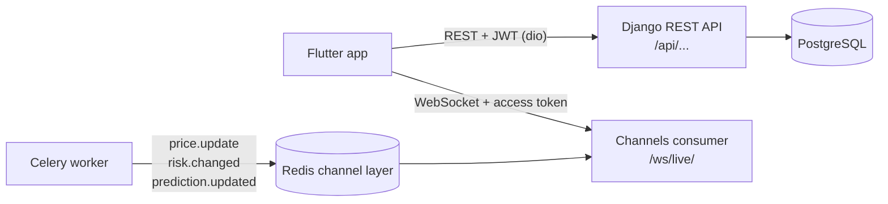

<p align="center">
  
</p>

<h1 align="center">Stock Risk Engine — Mobile</h1>

<p align="center">
  Flutter test client for the <b>Stock Portfolio Risk &amp; Forecasting Platform</b>.<br>
  Portfolios, ML risk labels and next-day forecasts over REST, plus live prices and risk alerts over one WebSocket.
</p>

---

## Contents

- [What the app does](#what-the-app-does)
- [How it fits with the backend](#how-it-fits-with-the-backend)
- [Features by role](#features-by-role)
- [Live risk monitoring](#live-risk-monitoring)
- [Tech stack](#tech-stack)
- [Project structure](#project-structure)
- [Getting started](#getting-started)
- [Running on each device](#running-on-each-device)
- [Test walkthrough](#test-walkthrough)
- [API endpoints used](#api-endpoints-used)
- [Design rules](#design-rules)
- [Troubleshooting](#troubleshooting)
- [Building a release](#building-a-release)

---

## What the app does

Investors track stock portfolios. Every holding gets two machine-learning outputs from the Django backend:

| Output | Values | Model |
|---|---|---|
| Risk label | low, medium, high | Random Forest |
| Next-trading-day direction | up, down | Gradient Boosting |

The models run every night and after training. The app shows those results, and while it is open it also shows what changes in between:

- **Live portfolio value** from near-live prices (Yahoo Finance, every 2 minutes during US market hours).
- **Risk-change alerts** such as `AAPL: medium → high`, pushed the moment a prediction run moves a label.
- **Recompute results** without polling: an analyst presses *Recompute* and the new prediction appears on every allowed screen.

> The WebSocket does not stream predictions. A price change during the day does not change tomorrow's prediction until the next daily run.

## How it fits with the backend



- The app only talks to the REST API and the WebSocket. It never connects to the database.
- The backend lives in a separate project: `stock_risk_engine_backend`.

## Features by role

Registration always creates an **investor**. An admin promotes users to analyst or admin.

### Investor

| Tab | What you can do |
|---|---|
| Home | Total value (live), gain/loss, risk distribution, portfolios with live values, latest risk alert banner |
| Portfolios | List, create, edit, delete portfolios; portfolio detail with live value, day change, risk overview and holdings |
| Holdings | Add, edit, delete; holding detail with live price chip, risk card, forecast card and price chart with the buy price marked |
| Stocks | Look up any ticker, see price history, and **Follow** it to keep a live price on the Stocks tab |
| Profile | Edit username and email, change password, log out |

### Analyst

| Tab | What you can do |
|---|---|
| Home | Live alert list for assigned clients, client summaries, high-risk holdings |
| Clients | Read-only portfolios of assigned investors (no add, edit or delete buttons) |
| Holding actions | **Recompute prediction** (waits for `prediction.updated`, falls back to polling after 30 s) and **Refresh prices** |

### Admin

| Tab | What you can do |
|---|---|
| Home | User counts, totals, latest price date, models in use with test metrics, live alert feed for every holding |
| Users | Change any user's role and assigned analyst (you cannot change your own role) |
| Portfolios | Every portfolio in the system, with edit and delete |
| Data and training | *Open in browser* links to the Django **Datasets** and **ML Training** pages |

## Live risk monitoring

The app opens **one** WebSocket after login and closes it on logout.

```
ws://<host>:8000/ws/live/?token=<access token>
```

The URL is built from `API_BASE_URL`: `http` becomes `ws`, `https` becomes `wss`.

| Event from the server | What the app does |
|---|---|
| `connection.ready` | Shows **Live** in the app bar and re-subscribes to every ticker on screen |
| `price.update` | Updates prices, values and day change; the price briefly highlights; label shows **Live** or **Daily close** |
| `risk.changed` | Adds an alert (`AAPL: medium → high`) and reloads the affected screen |
| `prediction.updated` | Finishes a recompute that is waiting for the same `task_id`; open holding screens reload |
| `pong` | Keeps the connection alive |
| `error` | Shows the message; the connection stays open unless the token is the problem |

**Session rules built into `lib/core/live_socket.dart`:**

- Sends `{"action": "ping"}` every 30 seconds. If nothing arrives for 75 seconds, it drops the socket and reconnects.
- Close code **4401** (expired token, password change, role change): refreshes the access token once and reconnects. If the refresh token is also rejected, the app logs out.
- Any other drop: reconnects after 1, 2, 4, 8, 16, then every 30 seconds.
- After reconnecting, it subscribes again to all tickers that open screens follow.
- Screens follow tickers with a reference count, so leaving one screen never unsubscribes a ticker another screen still shows.
- When the socket is not connected, screens keep the last REST data and show **Live updates paused**.

## Tech stack

| Package | Why it is used |
|---|---|
| `dio` | HTTP requests and the interceptor that adds the token and refreshes it once on 401 |
| `web_socket_channel` | The live connection |
| `flutter_secure_storage` | Stores the access and refresh tokens (Keychain on iOS, encrypted storage on Android) |
| `provider` | App state: session, live connection, services |
| `go_router` | Navigation and redirects (splash → login → home) |
| `fl_chart` | Price charts |
| `intl` | Money, number and date formatting |
| `url_launcher` | Opens the Django Datasets and ML Training pages for admins |

## Project structure

```
lib/
├── main.dart                     creates TokenStorage, ApiClient, LiveSocket, Session
├── app.dart                      providers, themes, MaterialApp.router
├── router.dart                   routes and login / role redirects
├── config/
│   ├── api_config.dart           base URL (--dart-define) and WebSocket URL
│   └── theme.dart                Material 3 themes and risk / gain colours
├── core/
│   ├── api_client.dart           dio, Bearer header, one refresh + retry on 401
│   ├── api_response.dart         status / message / data / errors + ApiException
│   ├── live_socket.dart          connect, ping, reconnect, 4401 handling, ticker follow counts
│   ├── token_storage.dart        secure token storage
│   ├── formatters.dart           money, percent, dates
│   └── json_utils.dart           safe JSON readers
├── state/
│   └── session.dart              login, register, restore, logout, session expiry
├── models/                       user, portfolio, holding, price, risk, forecast, dashboard, live_event, live_quote, page_result
├── services/                     auth, portfolio, holding, market, analytics, dashboard, users
├── screens/
│   ├── common/                   splash, login, register, profile, change password, home shell (bottom nav per role)
│   ├── investor/                 dashboard, portfolio form, holding form, stock lookup, stock detail
│   ├── shared/                   portfolio list, portfolio detail, holding detail, live alert feed (all roles)
│   ├── analyst/                  analyst dashboard
│   └── admin/                    admin dashboard, users list, user edit sheet
└── widgets/                      risk badge, direction badge, stat card, money text, live price chip,
                                  connection indicator, alert banner, price chart, paged list, state views
assets/
├── images/logo.png               logo used inside the app
└── branding/logo.svg             source logo (all launcher icons are rendered from it)
```

## Getting started

### Prerequisites

- Flutter (stable) with a Dart SDK that matches `pubspec.yaml`.
- The backend running locally with Redis, the Celery worker and Celery Beat (see the backend README).
- At least one admin account (`python manage.py createsuperuser`) and trained models for risk labels and forecasts.

### 1. Start the backend

```bash
cd stock_risk_engine_backend
python manage.py runserver 0.0.0.0:8000
celery -A stock_risk_engine_backend worker -l info
celery -A stock_risk_engine_backend beat -l info
```

The startup line must say `Starting ASGI/Daphne`. Plain WSGI cannot serve `/ws/live/`.

### 2. Install the app's packages

```bash
cd stock_risk_engine_mobile
flutter pub get
```

### 3. Run

```bash
flutter run --dart-define=API_BASE_URL=http://10.0.2.2:8000
```

If `API_BASE_URL` is not passed, the app uses `http://10.0.2.2:8000` on Android and `http://127.0.0.1:8000` everywhere else. The login screen and the Profile tab show the server address in use.

## Running on each device

| Target | Command | Backend requirement |
|---|---|---|
| Android emulator | `flutter run --dart-define=API_BASE_URL=http://10.0.2.2:8000` | `10.0.2.2` in `ALLOWED_HOSTS` |
| Physical phone (same Wi-Fi) | `flutter run --dart-define=API_BASE_URL=http://<computer IP>:8000` | Computer IP in `ALLOWED_HOSTS`, server started with `runserver 0.0.0.0:8000` |
| iOS simulator | `flutter run --dart-define=API_BASE_URL=http://127.0.0.1:8000` | none |
| Chrome | `flutter run -d chrome --web-port 3000 --dart-define=API_BASE_URL=http://127.0.0.1:8000` | `http://localhost:3000` in `CORS_ALLOWED_ORIGINS` (already there) |

Find the computer's Wi-Fi IP with `ipconfig getifaddr en0` (macOS), `ipconfig` (Windows) or `hostname -I` (Linux).

**Plain HTTP during testing.** Debug builds allow `http://` and `ws://`:

- Android: `android:usesCleartextTraffic="true"` in `android/app/src/debug/AndroidManifest.xml` (debug builds only).
- iOS: `NSAllowsLocalNetworking` in `ios/Runner/Info.plist`.

## Test walkthrough

This repeats the backend Postman journey in the app.

1. **Register** a new investor on the login screen. The app logs in straight away and opens the investor Home tab.
2. As **admin**, open **Users**, make a second account an **analyst**, then assign that analyst to the investor.
3. As the **investor**, create a portfolio and add a holding such as `AAPL`. If the server has no recent prices, it downloads them in the background.
4. Open the holding: risk label, forecast, confidence, model version and the price chart with the buy price line.
5. Log in as the **analyst** on a second device or in Chrome: the client's portfolio is visible with no edit buttons.
6. Keep the investor's holding screen open. As the analyst, press **Recompute prediction**. Both screens update without a refresh, and the analyst sees *Prediction updated live*.
7. Force a risk label change (for example by retraining or recomputing after new prices). The investor, their analyst and every admin get the alert. Other investors get nothing.
8. Turn Wi-Fi off and on. The app bar shows **Reconnecting**, then **Live**, and prices keep updating.
9. **Token expiry:** set `ACCESS_TOKEN_LIFETIME_MINUTES=15` (or `1` for a quick test) in the backend `.env`, restart the server and wait. The socket closes with 4401, the app refreshes the token and reconnects without the user noticing.
10. **Change password** from Profile: this device keeps working with the new token pair; other devices are logged out on their next request.
11. **Log out:** the refresh token is blacklisted and the live socket closes.

## API endpoints used

| Area | Endpoints |
|---|---|
| Accounts | `POST /api/accounts/register/`, `POST /api/accounts/login/`, `POST /api/accounts/token/refresh/`, `POST /api/accounts/logout/`, `GET/PATCH /api/accounts/me/`, `POST /api/accounts/change-password/` |
| Users (admin) | `GET /api/accounts/users/`, `PATCH /api/accounts/users/{id}/` |
| Portfolios | `GET/POST /api/portfolios/`, `GET/PATCH/DELETE /api/portfolios/{id}/`, `GET /api/portfolios/{id}/summary/`, `POST /api/portfolios/{id}/holdings/` |
| Holdings | `GET/PATCH/DELETE /api/holdings/{id}/` |
| Market | `GET /api/market/prices/{ticker}/`, `GET /api/market/prices/{ticker}/history/`, `POST /api/market/refresh/{ticker}/` |
| Analytics | `GET /api/analytics/holdings/{id}/risk/`, `GET /api/analytics/holdings/{id}/forecast/`, `POST /api/analytics/holdings/{id}/recompute/`, `GET /api/analytics/portfolio/{id}/risk-summary/`, `GET /api/analytics/tasks/{task_id}/` |
| Dashboards | `GET /api/dashboard/investor/`, `GET /api/dashboard/analyst/`, `GET /api/dashboard/admin/`, `GET /api/dashboard/holdings/{id}/trend/` |
| Live | `ws://<host>:8000/ws/live/?token=<access>` |

Every REST response uses `status`, `message`, `data` and `errors`. Field errors from `errors` are shown under the matching form field. Decimals arrive as strings and are parsed in the models.

## Design rules

- Material 3 with one seed colour (`#0E7490`), light and dark themes that follow the system.
- Phone width first; content is capped at 900 px so it stays readable on tablets and in Chrome.
- Bottom navigation per role: investor *Home, Portfolios, Stocks, Profile*; analyst *Home, Clients, Profile*; admin *Home, Users, Portfolios, Profile*.
- Same colours as the web pages: risk low green, medium amber, high red, not rated grey; direction up green, down red.
- Colour is never the only signal: badges always show the label text.
- Money uses two decimals and a currency symbol; gains are green with `+`, losses red with `−`.
- Every screen has loading, empty, error (with **Retry**) and success states; lists and dashboards support pull-to-refresh; long lists load more pages as you scroll.
- Destructive actions ask for confirmation.
- ML outputs show confidence and model version with a note that predictions are not financial advice.
- A small connection indicator in every app bar shows **Live**, **Reconnecting** or **Offline**.

## Troubleshooting

| Problem | Cause and fix |
|---|---|
| `Cannot reach the server at ...` | Wrong `API_BASE_URL`, Django not running, or the phone is on a different network. Open the base URL in the phone's browser to check. |
| `400 Bad Request` / `DisallowedHost` | The host you use is missing from `ALLOWED_HOSTS` in the backend settings. |
| Chrome: CORS error | Run Flutter web on port 3000 (`--web-port 3000`). |
| App bar stays on **Reconnecting** | The server was started without Daphne, or Redis database 4 (channel layer) is not running. |
| No live prices | Live prices only arrive during US market hours. Outside them, you see the latest daily close. |
| Recompute never finishes | The Celery worker is not running. After 30 seconds the app polls the task status and reports the result. |
| Logged out after changing the password on another device | Expected: a password change invalidates all older tokens. |
| `flutter analyze` reports `MyApp` in `test/widget_test.dart` | Delete the default counter test that came with `flutter create`. |

## Building a release

Release builds block plain HTTP. Before building one, deploy the backend behind HTTPS (see Phase 12 of the implementation plan) and point the app at it:

```bash
flutter build apk --dart-define=API_BASE_URL=https://api.example.com
flutter build web --dart-define=API_BASE_URL=https://api.example.com
```

The WebSocket then uses `wss://` automatically.

---

<p align="center"><sub>Risk labels and forecasts come from machine-learning models. They are not financial advice.</sub></p>
